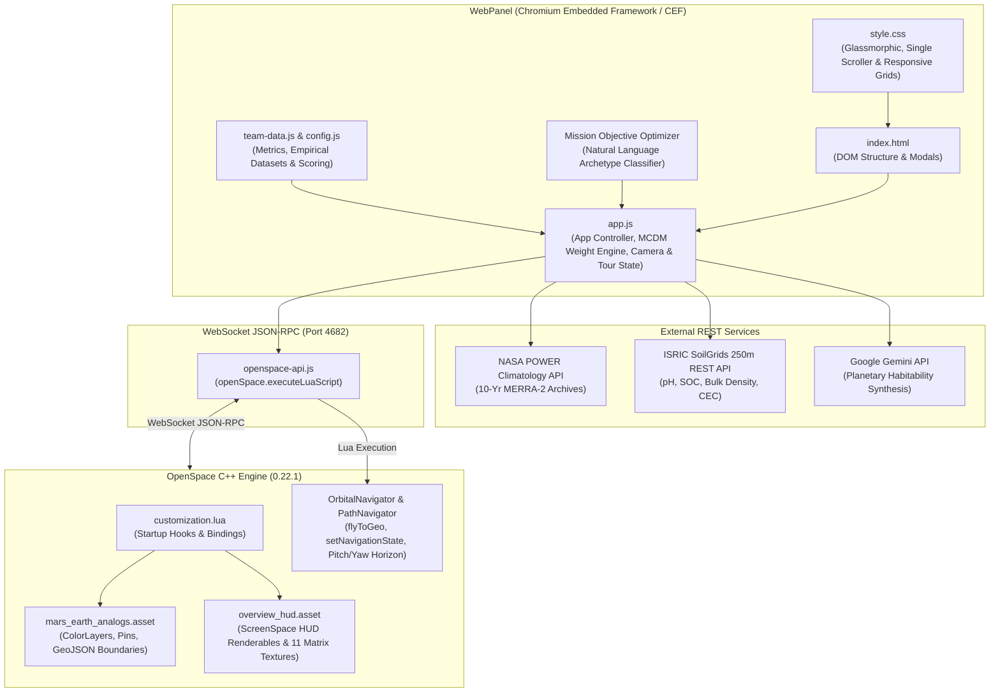

# OpenSpace *Mars vs Earth* — Technical Code One-Pager

## 1. System Topology & Data Flow

The project is structured into distinct execution layers operating across process and network boundaries:



---

## 2. File Directory & Core Module Responsibilities

| File Path | Language | Primary Responsibility |
|---|---|---|
| [`user/customization.lua`](file:///C:/Users/emily/.gemini/antigravity/scratch/openspace_mars_earth/user/customization.lua) | Lua | OpenSpace startup hook: loads assets, pauses simulation time, sets initial camera view. |
| [`data/assets/mars_earth_analogs/mars_earth_analogs.asset`](file:///C:/Users/emily/.gemini/antigravity/scratch/openspace_mars_earth/data/assets/mars_earth_analogs/mars_earth_analogs.asset) | Lua | Declares Scene Graph nodes, GeoJSON pins/boundaries, and planetary `ColorLayers` on Mars and Earth. |
| [`data/assets/mars_earth_analogs/overview_hud.asset`](file:///C:/Users/emily/.gemini/antigravity/scratch/openspace_mars_earth/data/assets/mars_earth_analogs/overview_hud.asset) | Lua | Declares 2D camera-space HUD textures (`ScreenSpace.CategoryOverviewHUD`, `ScreenSpace.OverlayLegendHUD`, `ScreenSpace.MatrixHUD`). |
| [`user/webpanels/mars_earth_analogs/js/openspace-api.js`](file:///C:/Users/emily/.gemini/antigravity/scratch/openspace_mars_earth/user/webpanels/mars_earth_analogs/js/openspace-api.js) | JavaScript | Low-level WebSocket client connecting WebPanel to OpenSpace on `ws://localhost:4682/json`. |
| [`user/webpanels/mars_earth_analogs/js/config.js`](file:///C:/Users/emily/.gemini/antigravity/scratch/openspace_mars_earth/user/webpanels/mars_earth_analogs/js/config.js) | JavaScript | Declares site coordinates, categories, tolerance scales ($\sigma$), and metadata. |
| [`user/webpanels/mars_earth_analogs/js/team-data.js`](file:///C:/Users/emily/.gemini/antigravity/scratch/openspace_mars_earth/user/webpanels/mars_earth_analogs/js/team-data.js) | JavaScript | Precomputed 10-year NASA POWER MERRA-2 and MSL Curiosity REMS ground truth climatology. |
| [`user/webpanels/mars_earth_analogs/js/app.js`](file:///C:/Users/emily/.gemini/antigravity/scratch/openspace_mars_earth/user/webpanels/mars_earth_analogs/js/app.js) | JavaScript | Master frontend controller: site selection, Side View Lua camera navigation, MCDM weights, SoilGrids query, stats tables, tour engine. |
| [`user/webpanels/mars_earth_analogs/css/style.css`](file:///C:/Users/emily/.gemini/antigravity/scratch/openspace_mars_earth/user/webpanels/mars_earth_analogs/css/style.css) | CSS | Responsive styling: single dedicated scrollbar, 2×2 button grid, anti-blowout rules, active glowing states. |
| [`soilgrids_maps.ipynb`](file:///C:/Users/emily/.gemini/antigravity/scratch/openspace_mars_earth/soilgrids_maps.ipynb) | Jupyter / Python | Planetary soil & regolith mapping pipeline pulling 250m global ISRIC SoilGrids REST telemetry. |
| [`scripts/generate_matrix_hud.py`](file:///C:/Users/emily/.gemini/antigravity/scratch/openspace_mars_earth/scripts/generate_matrix_hud.py) | Python | Pre-renders 11 high-contrast 1600×1020 mission-profile Decision Matrix HUD billboard textures. |
| [`scripts/generate_overview_hud_cards.py`](file:///C:/Users/emily/.gemini/antigravity/scratch/openspace_mars_earth/scripts/generate_overview_hud_cards.py) | Python | Generates ScreenSpace HUD cards and calibrated colorbar legends with metric annotations. |
| [`scripts/generate_planetary_overlays.py`](file:///C:/Users/emily/.gemini/antigravity/scratch/openspace_mars_earth/scripts/generate_planetary_overlays.py) | Python | Uses Cartopy/Matplotlib to render global $2048 \times 1024$ equirectangular raster overlays. |
| [`earthaccess_pull/pull_earthaccess.ipynb`](file:///C:/Users/emily/.gemini/antigravity/scratch/openspace_mars_earth/earthaccess_pull/pull_earthaccess.ipynb) | Python / Jupyter | Programmatic NASA earthaccess workflow extracting NASA EMIT L2B Mineral Composition & ICESat-2 data. |

---

## 3. Deep Dive: Key Code Mechanisms

### A. Tangent Planetary Horizon "Side View" & WASD Surface Walking (`app.js:868–965`)
To provide an eye-level panoramic ground perspective facing key geological landmarks, rightside up, with a perfectly level horizon and keyboard-driven surface walking:
```javascript
function sideView() {
  const site = getActiveSiteData();
  const globe = (site && site.globe) ? site.globe : "Earth";
  const cfg = SIDE_VIEW_CONFIGS[state.currentSiteKey];

  if (state.sideViewTimer) {
    clearTimeout(state.sideViewTimer);
    state.sideViewTimer = null;
  }

  // 1. Lock roll and follow planetary rotation so horizon stays permanently level
  const initScript = `
    if openspace.hasProperty("NavigationHandler.OrbitalNavigator.FollowAnchorNodeRotation") then
      openspace.setPropertyValueSingle("NavigationHandler.OrbitalNavigator.FollowAnchorNodeRotation", true)
    end
    if openspace.hasProperty("NavigationHandler.OrbitalNavigator.DisableRoll") then
      openspace.setPropertyValueSingle("NavigationHandler.OrbitalNavigator.DisableRoll", true)
    end
    if openspace.navigation and openspace.navigation.setFocus then
      openspace.navigation.setFocus('${globe}')
    end
  `;
  openSpace.executeLuaScript(initScript);

  // 2. Anti-Nadir Protection: If already in side view, smoothly re-level without calling flyToGeo
  if (state.isSideViewActive && state.sideViewSiteKey === state.currentSiteKey) {
    const tangentScript = `
      if openspace.navigation and openspace.navigation.isFlying and openspace.navigation.isFlying() then
        if openspace.pathnavigation and openspace.pathnavigation.stopPath then openspace.pathnavigation.stopPath() end
      end
      local cur = openspace.navigation.getNavigationState()
      local nav = { Pitch = ${cfg.pitch}, Anchor = "${globe}", Yaw = 0.0, Position = cur.Position, Up = cur.Up }
      openspace.navigation.setNavigationState(nav)
    `;
    openSpace.executeLuaScript(tangentScript);
    showWalkHintToast();
    return;
  }

  state.isSideViewActive = true;
  state.sideViewSiteKey = state.currentSiteKey;

  // 3. Approach flight to calibrated close-up coordinates
  openSpace.executeLuaScript(`openspace.navigation.flyToGeo('${globe}', ${cfg.camLat}, ${cfg.camLon}, ${cfg.camAlt}, 2.0)`);

  // 4. Upon arrival, stop path dampening and set Pitch = 1.38-1.40 rad, Yaw = 0.0 rad
  state.sideViewTimer = setTimeout(() => {
    const tangentScript = `
      if openspace.navigation and openspace.navigation.isFlying and openspace.navigation.isFlying() then
        if openspace.pathnavigation and openspace.pathnavigation.stopPath then openspace.pathnavigation.stopPath() end
      end
      local cur = openspace.navigation.getNavigationState()
      local nav = { Pitch = ${cfg.pitch}, Anchor = "${globe}", Yaw = 0.0, Position = cur.Position, Up = cur.Up }
      openspace.navigation.setNavigationState(nav)
    `;
    openSpace.executeLuaScript(tangentScript);
    state.sideViewTimer = null;
    showWalkHintToast();
  }, 2050);
}
```

#### Side View Configuration Table:
| Site Key | Globe | Camera Altitude | Pitch (rad) | Yaw (rad) | Target Landmark | Horizon Alignment |
|---|---|---|---|---|---|---|
| `mars_gale` | Mars | 3,800 m | 1.40 (~80.2°) | 0.0 | Mount Sharp (Aeolis Mons) & Yellowknife Bay | Rightside up, level horizon |
| `mcmurdo` | Earth | 2,400 m | 1.38 (~79.1°) | 0.0 | Taylor Valley trough framed by mountains | Zero roll, level horizon |
| `lut` | Earth | 1,800 m | 1.40 (~80.2°) | 0.0 | Kalut mega-yardang wind corridors | Level desert horizon |
| `aralkum` | Earth | 2,000 m | 1.40 (~80.2°) | 0.0 | Desiccated seabed salt flats & Ustyurt cliffs | Zero roll, level horizon |
| `uyuni` | Earth | 5,600 m | 1.40 (~80.2°) | 0.0 | Salar plain toward Volcán Tunupa (5,321 m) | Level horizon |

#### WASD Surface Walking Keyboard Bindings:
- **`W` / `ArrowUp`**: Walk forward along line of sight (`openspace.navigation.addTruckMovement(25.0)`).
- **`S` / `ArrowDown`**: Walk backward / step back (`openspace.navigation.addTruckMovement(-25.0)`).
- **`A` / `ArrowLeft`**: Turn / pan camera left (`openspace.navigation.addLocalRotation(-1.5, 0.0)`).
- **`D` / `ArrowRight`**: Turn / pan camera right (`openspace.navigation.addLocalRotation(1.5, 0.0)`).
- **`Shift + W / S`**: Sprint forward or backward at 3x speed (`addTruckMovement(75.0)`).
- **Dual-Mode Registration**: Binds natively in OpenSpace engine via `openspace.bindKey` and in webpanel DOM via `window.addEventListener("keydown")`.

### B. Multi-Criteria Decision Matrix (MCDM) & Silent Balancing (`app.js:2410–2530`)
Normalizes user weights across 5 categories and recalculates analog site ranking dynamically:
$$\text{Overall Match} = \frac{\sum_{i=1}^{5} w_i \cdot S_i}{\sum_{i=1}^{5} w_i}$$

When weights deviate from 100%, an inactive timer waits 10 seconds, then silently redistributes:
```javascript
function scheduleSilentRebalance(stationaryKey) {
  if (state.matrixRebalanceTimer) clearTimeout(state.matrixRebalanceTimer);

  state.matrixRebalanceTimer = setTimeout(() => {
    const weights = state.categoryWeights;
    const stationaryVal = weights[stationaryKey];
    const targetRemainder = 100 - stationaryVal;
    
    // Proportional redistribution across remaining categories
    const otherKeys = Object.keys(weights).filter(k => k !== stationaryKey);
    const otherSum = otherKeys.reduce((acc, k) => acc + weights[k], 0);

    otherKeys.forEach(k => {
      weights[k] = Math.round((weights[k] / otherSum) * targetRemainder);
    });

    renderMatrixInputs();
    updateMatrixViewportHUD();
    computeAllSiteCategoryScores();
  }, 10000);
}
```

### C. Mission Objective Optimizer Classifier (`app.js:2540–2610`)
Parses plain-English exploration objectives into optimal MCDM weight sets:
```javascript
const MISSION_ARCHETYPES = {
  mobility:    { thermal: 25, astrobiology: 10, dynamics: 40, moisture: 10, radiation: 15 },
  biosignature:{ thermal: 15, astrobiology: 50, dynamics: 10, moisture: 20, radiation: 5  },
  drone:       { thermal: 15, astrobiology: 5,  dynamics: 35, moisture: 5,  radiation: 40 },
  cryo:        { thermal: 40, astrobiology: 10, dynamics: 10, moisture: 35, radiation: 5  },
  isru:        { thermal: 15, astrobiology: 40, dynamics: 10, moisture: 10, radiation: 25 }
};
```

### D. SoilGrids 250m REST Astrobiology Integration (`app.js:2710–2790`)
Queries the ISRIC SoilGrids REST endpoint for arbitrary lat/lon coordinates:
```javascript
async function querySoilGridsAstrobiology(lat, lon) {
  const url = `https://rest.isric.org/soilgrids/v2.0/properties/query?lon=${lon}&lat=${lat}&property=phh2o&property=soc&property=bdod&property=cec&depth=0-5cm&value=mean`;
  const res = await fetch(url);
  const json = await res.json();
  
  // Extract and scale parameters
  const ph = json.properties.layers.find(l => l.name === "phh2o").depths[0].values.mean / 10.0;
  const soc = json.properties.layers.find(l => l.name === "soc").depths[0].values.mean / 10.0;
  const bdod = json.properties.layers.find(l => l.name === "bdod").depths[0].values.mean / 100.0;
  
  return { ph, soc, bdod };
}
```

### E. Multi-Preset Tour Flythrough Engine & Live Camera Sync (`app.js:2130–2570`)
Orchestrates automated camera choreography across three distinct preset durations with persistent UI highlighting:
```javascript
const TOUR_PRESET_CONFIGS = {
  "30s": { label: "30-Second Planetarium Demo", totalDuration: 30, stops: [ /* 5 stops x 6s */ ] },
  "1m":  { label: "1-Minute Standard Overview Tour", totalDuration: 60, stops: [ /* 6 stops x 10s */ ] },
  "5m":  { label: "5-Minute Comprehensive Presentation", totalDuration: 300, stops: [ /* 6 stops x 50s */ ] }
};
```
- **Persistent Preset Highlighting**: The chosen preset button remains highlighted (`.active`) throughout execution, pulsing (`.running`) while the tour is actively progressing. Defaulting to `1m` if `▶ Start Tour` is triggered without a preset.
- **Live Camera Position Query (`📍 Active Site`)**: Invokes `openspace.globebrowsing.geoPositionForCamera()` via WebSocket Lua to directly extract camera latitude, longitude, and altitude matching OpenSpace's top-left HUD (`Position: <lat>, <lon>`), staging coordinates for instant query.
- **Automated Flight on Query**: `🔬 Query SoilGrids Telemetry` executes `openSpace.flyToGeo("Earth", lat, lon, 250000.0, 2.5)` directly upon query execution.

### F. Distance-Based Similarity Framework (`app.js:285–350`)
Replaces ad-hoc linear heuristics with the cognitive metric learning similarity model (*Roads & Mozer, 2019*):
- **Step 2 (Normalized Differences)**:
  $$d_j = \frac{|X_{\text{Earth}, j} - X_{\text{Mars}, j}|}{T_j}$$
  Calibrated tolerances $T_j$: Temperature $20^\circ\text{C}$, Relative Humidity $20\%$, UVA $5.0\text{ W/m}^2$, UVB $0.5\text{ W/m}^2$, Wind $5.0\text{ m/s}$, Specific Humidity $5.0\text{ g/kg}$, Rain $1.0\text{ mm/d}$, Solar $15.0\text{ MJ/m}^2\text{/d}$, pH $1.5$, SOC $5.0\text{ g/kg}$, BDOD $0.40\text{ kg/dm}^3$.
- **Step 2b (Atmospheric Pressure Ratio)**:
  $$d_P = \left| \log_{10}\left( \frac{P_{\text{Earth}}}{P_{\text{Mars}}} \right) \right|$$
- **Step 3 (RMS Category Distance)**:
  $$D_c = \sqrt{\frac{1}{n} \sum_{j=1}^n d_j^2}$$
- **Step 5 (Exponential Similarity Kernel)**:
  $$S_c = 100 \cdot e^{-D_c}$$
- **Step 6 (Multi-Criteria Utility)**:
  $$\text{Overall Score} = \frac{\sum_{c=1}^5 w_c \cdot S_c}{\sum_{c=1}^5 w_c}$$

### G. Synthetic Intelligence (SI) Generation & Metadata Attribution
- **Submission Requirement Fulfillment**: *"Must acknowledge SI generation in descriptive text and metadata."*
- **Front-End Descriptive UI Attributions**:
  * Climatology modal drawer: `#about-si-attribution`
  * Planetary flythrough tour card: `.tour-si-attribution-tag`
  * SoilGrids habitability synthesis: `.astro-si-attribution-tag`
  * MCDM mission optimizer: `.optimizer-si-attribution-tag`
- **Programmatic Metadata**: `window.TEAM_METADATA.si_generation_acknowledgement` and `window.FALLBACK_METADATA.si_generation_acknowledgement` in `team-data.js` and `fallback-data.js`.
- **Zero Hallucinations Guarantee**: All telemetry inputs and tolerance scalings remain anchored exclusively to NASA POWER, MERRA-2, ISRIC SoilGrids v2.0, and MSL Curiosity REMS/CheMin in-situ ground truth.

---

## 4. Operational Cheat Sheet

- **Live Directory**: `C:\OpenSpace\OpenSpace-0.22.1\user\webpanels\mars_earth_analogs\`
- **Dev Repository**: `C:\Users\emily\.gemini\antigravity\scratch\openspace_mars_earth`
- **Sync Command**:
  ```powershell
  Copy-Item 'user\webpanels\mars_earth_analogs\css\style.css' 'C:\OpenSpace\OpenSpace-0.22.1\user\webpanels\mars_earth_analogs\css\style.css' -Force
  Copy-Item 'user\webpanels\mars_earth_analogs\js\app.js' 'C:\OpenSpace\OpenSpace-0.22.1\user\webpanels\mars_earth_analogs\js\app.js' -Force
  ```
- **Syntax Verification**: `node -c user/webpanels/mars_earth_analogs/js/app.js`

---

## 5. Screen Recording & Live Presentation Sync Guide

| Timestamp | Visual Action | Underlying Software Architecture |
|---|---|---|
| **`00:00 – 00:10`** | Select Gale Crater; click **`Side view`** button. Camera dives down to 3,800 m, tilts tangent to horizon, facing Mount Sharp. | `sideView()` → `flyToGeo` approach → `setNavigationState` (`Pitch = 1.42`, `Yaw = 3.14159`) via WebSocket JSON-RPC. |
| **`00:10 – 00:20`** | Click **`Comparison Matrix ▾`** dropdown. Drag *Dynamics* slider to 40%. Formula updates live. | `input` event listener → mathematical normalization $\sum (w_i S_i) / \sum w_i$ → silent 10s auto-balancer armed. |
| **`00:20 – 00:30`** | Type *"rover mobility"* into the Mission Optimizer; click **Apply**. Viewport HUD swaps to dynamics/traverse texture. | Regex archetype classifier → `state.categoryWeights` updated → `updateMatrixViewportHUD()` updates `ScreenSpace.MatrixHUD`. |
| **`00:30 – 00:40`** | Click **`🧬 Find Astrobiology Data`**; select **`🏜️ Atacama`** preset; click **`Query`**. Camera flies to -24.50°, -69.25°. | `querySoilGridsAstrobiology()` REST fetch → OpenSpace camera dispatch `flyToGeo("Earth", lat, lon, 250000, 2.5)`. |
| **`00:40 – 00:50`** | View returned SoilGrids regolith properties (pH 8.1, SOC 0.2 g/kg, bulk density 1.45 kg/dm³). | Astrobiological habitability synthesis rendered into modal DOM. |
