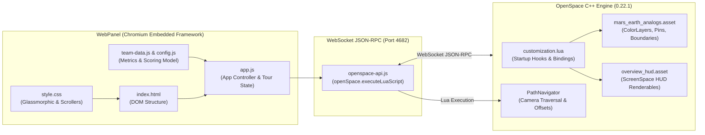

# OpenSpace *Mars vs Earth* — Technical Code One-Pager

## 1. System Topology & Data Flow

The project is structured into three distinct execution layers operating across process boundaries:



---

## 2. File Directory & Core Module Responsibilities

| File Path | Language | Primary Responsibility |
|---|---|---|
| [`user/customization.lua`](file:///C:/Users/emily/.gemini/antigravity/scratch/openspace_mars_earth/user/customization.lua) | Lua | OpenSpace startup hook: loads assets, pauses simulation time, sets initial camera view. |
| [`data/assets/mars_earth_analogs/mars_earth_analogs.asset`](file:///C:/Users/emily/.gemini/antigravity/scratch/openspace_mars_earth/data/assets/mars_earth_analogs/mars_earth_analogs.asset) | Lua | Declares Scene Graph nodes, GeoJSON pins/boundaries, and planetary `ColorLayers` on Mars and Earth. |
| [`data/assets/mars_earth_analogs/overview_hud.asset`](file:///C:/Users/emily/.gemini/antigravity/scratch/openspace_mars_earth/data/assets/mars_earth_analogs/overview_hud.asset) | Lua | Declares 2D camera-space HUD textures (`ScreenSpace.CategoryOverviewHUD`, `ScreenSpace.OverlayLegendHUD`). |
| [`user/webpanels/mars_earth_analogs/js/openspace-api.js`](file:///C:/Users/emily/.gemini/antigravity/scratch/openspace_mars_earth/user/webpanels/mars_earth_analogs/js/openspace-api.js) | JavaScript | Low-level WebSocket client connecting WebPanel to OpenSpace on `ws://localhost:4682/json`. |
| [`user/webpanels/mars_earth_analogs/js/config.js`](file:///C:/Users/emily/.gemini/antigravity/scratch/openspace_mars_earth/user/webpanels/mars_earth_analogs/js/config.js) | JavaScript | Declares site coordinates, categories, tolerance scales ($\sigma$), and metadata. |
| [`user/webpanels/mars_earth_analogs/js/team-data.js`](file:///C:/Users/emily/.gemini/antigravity/scratch/openspace_mars_earth/user/webpanels/mars_earth_analogs/js/team-data.js) | JavaScript | Precomputed 10-year NASA POWER MERRA-2 and MSL Curiosity REMS ground truth climatology. |
| [`user/webpanels/mars_earth_analogs/js/app.js`](file:///C:/Users/emily/.gemini/antigravity/scratch/openspace_mars_earth/user/webpanels/mars_earth_analogs/js/app.js) | JavaScript | Master frontend controller: site selection, camera flights, UI rendering, stats tables, tour engine. |
| [`user/webpanels/mars_earth_analogs/css/style.css`](file:///C:/Users/emily/.gemini/antigravity/scratch/openspace_mars_earth/user/webpanels/mars_earth_analogs/css/style.css) | CSS | Responsive styling: 2×2 button grid, anti-blowout rules, horizontal scrollbars, active glowing states. |
| [`data/analogLocationCSV/*.csv`](file:///C:/Users/emily/.gemini/antigravity/scratch/openspace_mars_earth/data/analogLocationCSV) | CSV | NASA POWER 10-year in-situ daily archives (2015–2025; 4,018 daily records per analog site). |
| [`data/analogLocationCSV/soil_ph_summary.csv`](file:///C:/Users/emily/.gemini/antigravity/scratch/openspace_mars_earth/data/analogLocationCSV/soil_ph_summary.csv) | CSV | Empirical Soil & Regolith pH summary (Min, Max, Mean) for all analog sites vs Mars baseline. |
| [`earthaccess_pull/pull_earthaccess.ipynb`](file:///C:/Users/emily/.gemini/antigravity/scratch/openspace_mars_earth/earthaccess_pull/pull_earthaccess.ipynb) | Python / Jupyter | Programmatic NASA earthaccess workflow extracting NASA EMIT L2B Mineral Composition (`EMITL2BMIN.002`) & ICESat-2 data. |
| [`earthaccess_pull/tiff_convert.py`](file:///C:/Users/emily/.gemini/antigravity/scratch/openspace_mars_earth/earthaccess_pull/tiff_convert.py) | Python | GeoTIFF to NumPy array and Pandas DataFrame CSV export utility. |
| [`earthaccess_pull/out.csv`](file:///C:/Users/emily/.gemini/antigravity/scratch/openspace_mars_earth/earthaccess_pull/out.csv) | CSV | Exported 4,424×4,184 matrix of NASA EMIT L2B mineral identification band-depth and mineral ID values. |
| [`earthaccess_pull/out.tif`](file:///C:/Users/emily/.gemini/antigravity/scratch/openspace_mars_earth/earthaccess_pull/out.tif) | GeoTIFF | 16-bit GeoTIFF (WGS 84, 4,424×4,184) capturing spatial altimetry relief. |
| [`earthaccess_pull/lut.tif`](file:///C:/Users/emily/.gemini/antigravity/scratch/openspace_mars_earth/earthaccess_pull/lut.tif) | GeoTIFF | NASA EMIT L2B mineral classification GeoTIFF (WGS 84, 1,327×2,511) mapping pyroxenes, hematite, and goethite for the Lut Desert. |
| [`earthaccess_pull/araldesert.tif`](file:///C:/Users/emily/.gemini/antigravity/scratch/openspace_mars_earth/earthaccess_pull/araldesert.tif) | GeoTIFF | NASA EMIT L2B mineral classification GeoTIFF (WGS 84, 442×418) mapping toxic sulfates (mirabilite/thenardite) for Aralkum. |
| [`scripts/process_team_data.py`](file:///C:/Users/emily/.gemini/antigravity/scratch/openspace_mars_earth/scripts/process_team_data.py) | Python | ETL pipeline aggregating raw NASA POWER daily CSVs into structured climatology JSON. |
| [`scripts/generate_planetary_overlays.py`](file:///C:/Users/emily/.gemini/antigravity/scratch/openspace_mars_earth/scripts/generate_planetary_overlays.py) | Python | Uses Cartopy/Matplotlib to render global $2048 \times 1024$ equirectangular raster overlays. |
| [`scripts/generate_overview_hud_cards.py`](file:///C:/Users/emily/.gemini/antigravity/scratch/openspace_mars_earth/scripts/generate_overview_hud_cards.py) | Python | Generates ScreenSpace HUD cards and calibrated colorbar legends with metric annotations. |

---

## 3. Deep Dive: Key Code Mechanisms

### A. Mathematical Camera Viewport Offset (`app.js:40–110`)
Because the interactive WebPanel occupies the right $360\text{ px}$ of the screen, centering directly on a latitude/longitude coordinate leaves the geological feature partially hidden. The camera engine applies a mathematical longitude offset ($\Delta\lambda = +4.5^\circ$ on Mars, $+4.0^\circ$ on Earth):
```javascript
const SITE_CAMERA_TARGETS = {
  mars_gale: { lat: -4.59,  lon: 137.44 + 4.5, alt: 240000.0, globe: "Mars" },
  lut:       { lat: 30.20,  lon: 58.80  + 4.0, alt: 240000.0, globe: "Earth" },
  mcmurdo:   { lat: -77.50, lon: 162.00 + 4.0, alt: 240000.0, globe: "Earth" },
  aralkum:   { lat: 44.50,  lon: 60.00  + 4.0, alt: 240000.0, globe: "Earth" },
  uyuni:     { lat: -20.27, lon: -67.48 + 4.0, alt: 240000.0, globe: "Earth" }
};
```
Executing via OpenSpace Lua:
```lua
openspace.pathnavigation.flyToNavigationNode("Mars", 3.5)
openspace.navigation.goToGeo("Mars", -4.59, 141.94, 240000.0, 3.5)
```

### B. Screen-Aligned 2D Legend HUD (`overview_hud.asset:30–45`)
To keep HUD badges perfectly upright and flat against the viewport during planetary rotation:
```lua
CartesianPosition = { -1.13, 0.55, -2.0 },
Scale = 0.44,
FaceCamera = false
```
`FaceCamera = false` prevents the badge from tilting or rolling with the camera, locking it horizontally in the upper-left corner.

### C. Exponential Analog Similarity Scoring (`config.js:210–225`)
Computes normalized similarity scores ($0\text{–}100\%$) between Earth measurements and Mars REMS baselines using parameter-specific tolerance scales ($\sigma$):
```javascript
function calcSimScore(earthVal, marsVal, scale) {
  if (earthVal === null || marsVal === null || !scale) return null;
  const delta = Math.abs(earthVal - marsVal);
  return Math.max(0, Math.min(100, 100 * Math.exp(-delta / scale)));
}
```

### D. Horizontal Scrolling Compact Stats Table (`style.css:1340–1475`)
Prevents text squishing and column collision (`GALEMATCH DE CRATER`) in the narrow sidebar:
```css
.compact-stats-container {
  overflow-x: auto;
  overflow-y: hidden;
  -webkit-overflow-scrolling: touch;
  scrollbar-width: thin;
  scrollbar-color: rgba(56, 189, 248, 0.55) rgba(15, 23, 42, 0.9);
}
.compact-stats-inner {
  display: flex;
  flex-direction: column;
  gap: 5px;
  padding: 4px 12px 8px 6px;
  width: max-content;   /* Dynamically expands to widest content */
  min-width: 100%;      /* Fills container when content is narrow */
  box-sizing: border-box;
}
.compact-stats-row-group {
  overflow: visible;    /* Ensures right-hand value columns are never clipped */
  width: 100%;
}
.cstat-td.earth-col, .cstat-td.mars-col {
  white-space: nowrap;  /* Prevents numbers and units from wrapping awkwardly */
  text-align: right;
}
```

### E. Tour Playback State Machine (`app.js:1395–1440 & 1695–1745`)
A synchronized dual-button state machine:
```javascript
// Start / End Tour Toggle
if (btnTourPlay) {
  btnTourPlay.addEventListener("click", () => {
    if (state.tourActive || btnTourPlay.innerText.includes("End Tour")) {
      stopTour(); // Immediately terminates flights, overlays, HUDs; resets index to 0
    } else {
      startOrResumeTour(0); // Switches button to "⏹ End Tour" (.btn-tour-end)
    }
  });
}

// Pause / Play Toggle
if (btnTourPause) {
  btnTourPause.addEventListener("click", () => {
    if (state.tourActive) {
      pauseTour(); // Halts timer, switches button to "▶ Play" (.btn-tour-resume)
    } else {
      startOrResumeTour(state.tourIndex || 0); // Resumes from current step, switches to "⏸ Pause"
    }
  });
}
```

---

## 4. Operational Cheat Sheet

- **Live Directory**: `C:\OpenSpace\OpenSpace-0.22.1\user\webpanels\mars_earth_analogs\`
- **Dev Repository**: `C:\Users\emily\.gemini\antigravity\scratch\openspace_mars_earth`
- **Sync Command**:
  ```powershell
  Copy-Item 'user\webpanels\mars_earth_analogs\css\style.css' 'C:\OpenSpace\OpenSpace-0.22.1\user\webpanels\mars_earth_analogs\css\style.css' -Force
  Copy-Item 'user\webpanels\mars_earth_analogs\js\app.js' 'C:\OpenSpace\OpenSpace-0.22.1\user\webpanels\mars_earth_analogs\js\app.js' -Force
  ```
- **Syntax Verification**: `node -c user/webpanels/mars_earth_analogs/js/app.js`

---

## 5. 45-Second Tour Voiceover Script (Code & Software Architecture)

*Designed for screen recording during the automated tour playback. Target word count: ~115 words (~45 seconds at 150 wpm).*

### 🎙️ Narration Script (Teleprompter Format)

> **[00:00 – 00:10]**  
> *"Under the hood, our platform connects a custom HTML5 and JavaScript web panel to the OpenSpace astro-visualization engine through a local WebSocket JSON-RPC bridge on port 4682."*

> **[00:10 – 00:22]**  
> *"As the automated tour launches, our state machine dispatches asynchronous Lua commands to OpenSpace's PathNavigator, dynamically calculating orbital camera trajectories with mathematical longitude offsets so geological features remain perfectly framed alongside the HUD."*

> **[00:22 – 00:35]**  
> *"Across each flyover, our exponential decay scoring algorithm computes real-time multi-metric similarity scores—benchmarking ten-year NASA POWER daily climate archives against MSL Curiosity REMS ground truth on Mars."*

> **[00:35 – 00:45]**  
> *"Synchronized screen-space HUD renderables and planetary color layers load instantaneously, delivering fully grounded, zero-hallucination planetary analog science in real time."*

---

### 🎬 Screen Recording Sync Guide

| Timestamp | Visual Screen Action | Underlying Code & Software Component |
|---|---|---|
| **`00:00 – 00:10`** | Click **`▶ Start Tour`** in sidebar; camera pulls back from Mars Gale Crater. | `app.js` (`btnTourPlay` state machine) → `openspace-api.js` WebSocket dispatch. |
| **`00:10 – 00:22`** | Interplanetary transit flight from Mars to Earth; smooth descent into analog site. | Lua `openspace.navigation.goToGeo` with mathematical offset ($\Delta\lambda = +4.0^\circ$). |
| **`00:22 – 00:35`** | Sidebar updates with site telemetry, score rank, and category breakdown. | `calcSimScore(S = 100 \cdot e^{-|\Delta|/\sigma})` against `team-data.js` NASA archive. |
| **`00:35 – 00:45`** | 2D HUD Overview card displays in upper-left viewport; site pins illuminate. | `overview_hud.asset` (`ScreenSpaceRenderableImageFlat` with `FaceCamera = false`). |

